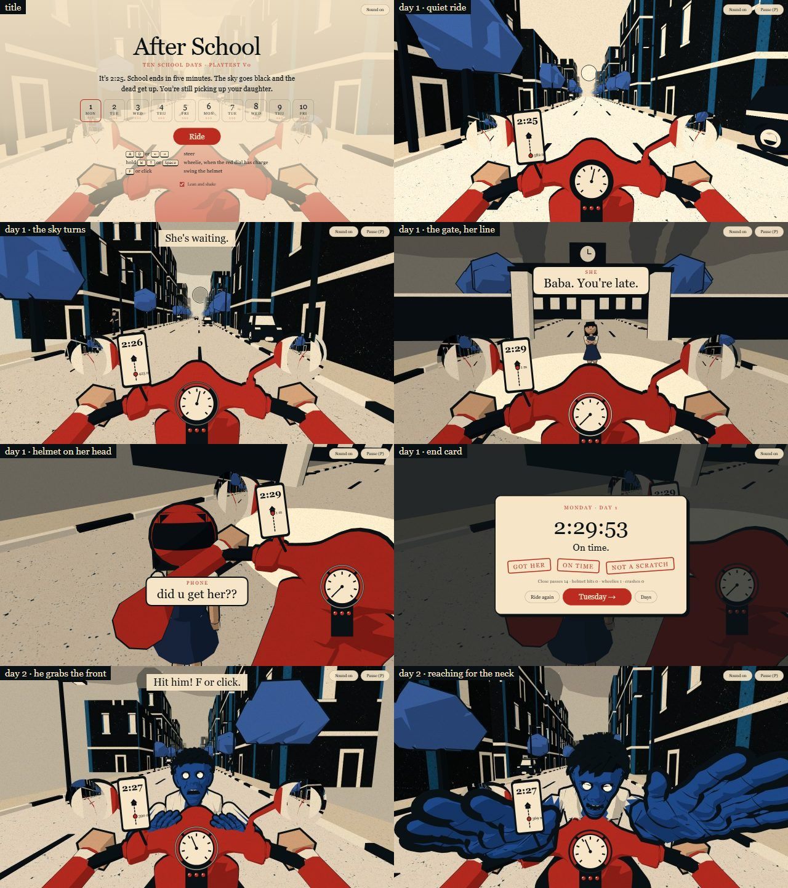
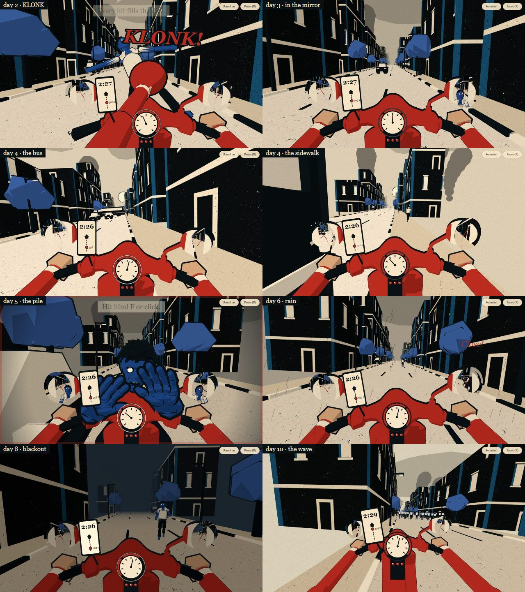

# After School · V0 · ten school days

> It's 2:25. School ends in five minutes. The sky goes black and the dead get up. You're still picking up your daughter.

**Play it now:** https://ayn-2024.github.io/ASA/ (a computer with a keyboard).

A first-person scooter game. An ordinary dad, a 150cc scooter, a helmet, and a gate to reach by 2:30. Funny and frightening, no gore, no guns. This is the first build that is a whole game: ten days, each one ends at the school gate with her.

**Status, 11 November 2026:** playable from the title to the end of day 10. Built and checked by bots and by headless screenshots. **Not yet played by a human.**




## Play

Open `index.html` in Chrome or Edge on a computer. It needs internet once, for Three.js. Landscape, keyboard and mouse.

| Do | Keys |
|---|---|
| Steer | `A` `D` or `←` `→` |
| Wheelie (needs charge on the red dial) | hold `W`, `↑` or `Space` |
| Swing the helmet | `F`, or click |
| Pause · sound | `P` · `M` |

Touch works too (drag to steer, two buttons), but it has not been tried on a real phone.

## How it plays

- **The dial.** Close passes of moving cars and every helmet hit fill it. A wheelie drains it.
- **Front.** Ride into a zombie and he wraps the steering column, climbs, and reaches for your neck. The dark closes in. Hit him.
- **Back.** Brush past one and he takes the back rail. You feel the weight, and you see him only in the mirrors. A wheelie throws him off.
- **You cannot wheelie while one holds the front.**
- **A wheelie rides over cars and over zombies.** You feel each one.
- **People are never hurt.** Bump one on the sidewalk and you lose speed, nothing else.
- **Three lives** (the red lights under the dial). A car, the bus, or being eaten costs one.
- **The clock** on the phone runs 2:25 to 2:30. Late is not failure; on time is a stamp.
- **Three stamps a day:** Got her · On time · Not a scratch.

## The ten days

| Day | | New |
|---|---|---|
| 1 | Monday | The ride, the sky turning, close passes, the wheelie over a wall of cars |
| 2 | Tuesday | The first zombie and the helmet (the first one cannot hurt you) |
| 3 | Wednesday | Zombies on the back rail, seen in the mirrors |
| 4 | Thursday | The bus across the road, the sidewalk, people |
| 5 | Friday | The pile: a second one climbs over the first |
| 6 | Monday | Rain: the scooter slides |
| 7 | Tuesday | Gridlock: threading parked traffic |
| 8 | Wednesday | Blackout |
| 9 | Thursday | Everything, and piles of three |
| 10 | Friday | A wall of them before the gate |

## What is real and what is a stand-in

- **The creator's own models:** the red scooter, the zombie's head and shoulders (bust), and the zombie's hands. Coloured in code by measured regions, since the files carry no colour.
- **Built in code:** the zombie's body, arms and legs under that bust; the fleeing adults; the daughter; the bus; the school; Baba's arms and the helmet. All animation is code (a 14-bone skeleton, hands placed by two-bone reach).
- **Cars:** Kenney Car Kit (CC0), repainted cream and ink.
- **Sound:** synthesized placeholders. No recordings, no music.
- **Lines:** the story lines the creator decided are marked `decided` in `src/levels.js`. Every other line of text is a draft to rewrite.

## Evidence

- `node --test test/rules.test.cjs test/sim.test.cjs`: 29 tests. They include bots of three skill levels riding all ten days twelve times each; the test prints the table (finished, on time, lives lost).
- `node tools/shots.cjs`: plays set moments in headless Chrome and saves the two sheets above.
- Measured on the creator's PC (Intel Iris Xe, headless Chrome, 1280×720): 60 frames a second on the title ride, about 180 to 250 draw calls.

Not measured: any phone, any human player, sound by ear.

## Build

```
node build.cjs            # writes dist/index.html, one self-contained page
node tools/shots.cjs      # screenshots (needs Chrome or Edge)
```

No npm packages. Node 22 or newer. Three.js 0.170.0 comes from jsDelivr at run time.

```
src/rules.js    the lab's tested ride rules (dial, wheelie, lives)
src/sim.js      one day as pure rules: cars, zombies front and back, the bus, people, the clock
src/levels.js   the ten days and their lines
src/bot.js      the bot that plays the tests and rides behind the title
src/world.js    street, sky, traffic, bus, school gate
src/rider.js    scooter cockpit, mirrors, Baba's arms, helmet
src/figures.js  zombie, adults, daughter: skeleton, poses, reach
src/hud.js      dial, phone, captions, the bite
src/game.js     draws what the rules say
src/app.js      screens, input, saving
```

## Credits

- Game, story, scooter, zombie bust and hand models: Alaa Najjar (AYN Beirut). All rights reserved unless stated otherwise.
- Code written with Claude (Anthropic).
- Cars: [Kenney Car Kit](https://kenney.nl/assets/car-kit), CC0. See `assets/KENNEY-LICENSE.txt`.
- [Three.js](https://threejs.org) 0.170.0, MIT, loaded from jsDelivr.
